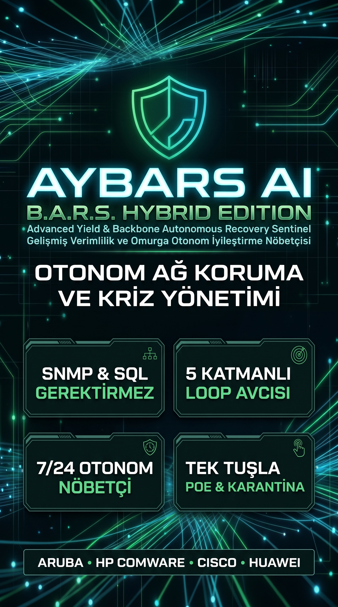

\# 🛡️ AYBARS AI — V12.4 \[B.A.R.S. Hybrid Edition]

\*\*A.Y.B.A.R.S.:\*\* \*Advanced Yield \& Backbone Autonomous Recovery Sentinel\*

\*(Gelişmiş Verimlilik ve Omurga Otonom İyileştirme Nöbetçisi)\*

\[!\[Edition](https://img.shields.io/badge/Edition-V12.4%20B.A.R.S.%20Hybrid-00FF41?style=for-the-badge\&logoColor=black)](https://github.com)

\[!\[Architecture](https://img.shields.io/badge/Architecture-SNMP--Free%20%7C%20Zero--SQL-00BFFF?style=for-the-badge)](https://github.com)

\[!\[License](https://img.shields.io/badge/License-Commercial%20(AYB--HWID)-FF4444?style=for-the-badge)](https://github.com)

\[!\[Vendors](https://img.shields.io/badge/Multi--Vendor-Aruba%20%7C%20Comware%20%7C%20Cisco%20%7C%20Huawei-4CAF50?style=for-the-badge)](https://github.com)

\[🇹🇷 Türkçe Tanıtım](#-türkçe-genel-bakış) • \[🇬🇧 English Overview](#-english-overview) • \[⚔️ Klasik NMS Karşılaştırması](#%EF%B8%8F-geleneksel-nms-yazılımları-ile-farkı) • \[📩 Kurumsal Demo](#-kurumsal-demo-ve-lisanslama--enterprise-demo)

\---

\## 🇹🇷 Türkçe Genel Bakış

\*\*AYBARS AI \[B.A.R.S. Hybrid Edition]\*\*; hastaneler, kamu kurumları ve büyük ölçekli kampüs ağları için geliştirilmiş, ağır SQL veritabanları veya karmaşık SNMP/MIB yapılandırması gerektirmeyen \*\*yapay zeka destekli otonom ağ izleme, kendi kendini iyileştirme (Self-Healing) ve aktif müdahale\*\* platformudur.

Piyasadaki klasik NMS yazılımları yalnızca pasif grafikler çizerken, \*\*AYBARS AI\*\* doğrudan kıdemli bir ağ mühendisi gibi çoklu marka CLI (SSH/Telnet) üzerinden switch'lerle konuşur; arızayı nokta atışı tespit eder ve tek tuşla müdahale imkanı sunar.

\### 🚀 Öne Çıkan Çekirdek Yetenekler

\* \*\*🌪️ 5 Katmanlı B.A.R.S. Loop Avcısı:\*\* Aruba AOS-CX (`Bpdu-Error`, `Loop-Protect`, `Self-LLDP`) ve HP/H3C Comware 7 (`BPDU-Protection`, `STP Down-Port`, `Loopback-Detection`, `Self-LLDP`) katmanlarını eşzamanlı tarayarak ağ döngülerini saniyeler içinde yakalar.

\* \*\*♻️ 15 Dakika Otonom İyileşme (Self-Healing):\*\* Döngü oluşturan kablo fiziksel olarak çıkarıldığında, kilitlenen kenar portlar yönetici müdahalesine gerek kalmadan 900. saniyede kendiliğinden devreye girer.

\* \*\*📊 Deterministik Delta Motoru \& Sıfır Gürültü Politikası:\*\* Switch sayaçları sıfırlanmasa bile iki tarama arasındaki matematiksel farkı (`%0 hata payı`) hesaplar. Access Point kaynaklı `Giants (MTU 1500)` ve hız farkı kaynaklı `Dropped 0 (TX Buffer)` kayıtlarını eler; yalnızca eşik üstü (\*\*+100\*\*) gerçek fiziksel kablo/SFP arızalarında alarm üretir.

\* \*\*🛡️ Proaktif Koruma Sensörleri:\*\*

&#x20; \* \*\*🌡️ SFP DOM/DDM Optik Lazer Sensörü:\*\* Fiber modüllerin sıcaklık (°C) ve Rx/Tx desibel (dBm) değerlerini ölçerek `-14.5 dBm` / `-17.0 dBm` altındaki zayıflamaları CRC patlamadan önce raporlar.

&#x20; \* \*\*🕵️ DHCP'siz IP Çakışma Avcısı (ARP Bekçisi):\*\* Merkez DHCP sunucusuna erişim yetkisi olmadan omurga ARP tablosunu referans alır; korsan IP çakışmasını ve bağlı olduğu kenar portu anında yakalar.

\* \*\*⚡ Tek Tuşla Aktif Müdahale:\*\* Web arayüzünden \*\*PoE Kamera/AP Şoklama (Kapat/Aç)\*\*, \*\*Port Karantina (Shutdown)\*\*, \*\*VLAN Atama\*\*, \*\*Evrensel IP/MAC Nokta Atışı Bulucu\*\*, \*\*Toplu Konfigürasyon (Mass-Config)\*\* ve \*\*Tek Tıkla Tüm Ağ Yedekleme (.ZIP)\*\*.

\* \*\*🧠 Yapay Zeka Kriz Masası \& Türkçe Sesli Anons:\*\* Deterministik Delta çıktıları üzerinden kök neden analizi yapar, kritik bulguları kırmızı alarm kutularıyla vurgular ve Türkçe sesli özetler.

\* \*\*🔔 7/24 Otonom Arka Plan Nöbetçisi:\*\* Tarayıcı kapalıyken tekil PID kilidiyle sessizce çalışır; cihaz kesintisi (`DOWN`), ağ döngüsü (`LOOP`), IP çakışması veya fiziksel hata sıçramasında anında HTML acil e-posta gönderir.

\### ⚔️ Geleneksel NMS Yazılımları ile Farkı

| Özellik / Yetenek | Klasik NMS (SolarWinds / PRTG / OpManager / Zabbix) | AYBARS AI \[B.A.R.S. Hybrid] |

| :--- | :--- | :--- |

| \*\*Kurulum \& Altyapı\*\* | SQL Veritabanı, SNMP v2/v3 ve MIB kütüphaneleri şarttır. | \*\*SNMP-Free \& Zero-SQL:\*\* Doğrudan SSH/Telnet ile 5 dakikada hazır. |

| \*\*Ağ Döngüsü (Loop) Tespiti\*\* | Port kapandığında "Port Down" sanarak sessiz kalır. | \*\*5 Katmanlı Avcı:\*\* `Bpdu-Error`, `BPDU-Protection` ve `Self-LLDP` köprülerini yakalar. |

| \*\*Alarm Gürültüsü\*\* | Küçük paket düşmelerinde yüzlerce sahte mail gönderir. | \*\*Zero-Noise Delta:\*\* `Dropped 0` ve `Giants` elenir, sadece gerçek arızada alarm verir. |

| \*\*Aktif Müdahale\*\* | Sadece izler; müdahale için PuTTY / CLI gerekir. | \*\*Tek Ekranda Müdahale:\*\* PoE Şoklama, Port Karantina, Mass-Config ve Toplu Yedek. |

| \*\*Güvenlik \& Lisans\*\* | Ağır sunucu ve modül başına yüksek lisans maliyeti. | `AYB-HWID` donanım kilidi, Anti-Rollback, Brute-Force koruması, `shell=False` zırhı. |

\### 🖧 Desteklenen Switch Markaları (Multi-Vendor CLI)

\* \*\*Aruba AOS-CX (SSH):\*\* 6100, 6200F, 6300, 8100, 8325 Serisi

\* \*\*HP / H3C Comware v5 \& v7 (SSH / Telnet):\*\* 5120, 5130, 5140 EI/SI, 5500 Serisi

\* \*\*Cisco IOS / IOS-XE (SSH):\*\* Catalyst 2960, 3650, 3850, 9200, 9300 Serisi

\* \*\*Huawei VRP (SSH):\*\* CloudEngine S5700, S5720, S6720 Serisi

\* \*\*HP ProCurve / ArubaOS-Switch (SSH):\*\* 2530, 2540, 2920, 2930F Serisi

\---

\## 🇬🇧 English Overview

\*\*AYBARS AI \[B.A.R.S. Hybrid Edition]\*\* (\*Advanced Yield \& Backbone Autonomous Recovery Sentinel\*) is an enterprise-grade, \*\*SNMP-free and Zero-SQL\*\* autonomous network protection, self-healing, and crisis management platform built for hospitals, government institutions, and multi-vendor campus networks.

\### Key Highlights

\* \*\*Zero-SNMP Multi-Vendor CLI Abstraction:\*\* Manage Aruba AOS-CX, HP/H3C Comware, Cisco IOS/IOS-XE, Huawei VRP, and HP ProCurve from a unified command center without configuring SNMP/MIBs or SQL databases.

\* \*\*5-Layer B.A.R.S. Loop Hunter:\*\* Detects `Bpdu-Error`, `BPDU-Protection`, `Loop-Protect`, `Self-LLDP` physical cable bridges, and STP anomalies across heterogeneous edge switches.

\* \*\*Deterministic Zero-Noise Delta Engine:\*\* Filters out TX buffer queue drops (`Dropped 0`) and AP `Giants (MTU 1500)` noise, alerting exclusively on verified physical layer errors (`CRC`, `Input Error`, `Collision`, `Frame`) above threshold.

\* \*\*Proactive Hardware Telemetry:\*\* Optical SFP DOM/DDM laser attenuation tracking and DHCP-less Core ARP Spoof / IP conflict detection.

\* \*\*One-Click Remediation:\*\* Remote PoE power cycling, instant port quarantine, universal IP/MAC edge-port pinpointing, Mass-Config push, and automated multi-switch configuration backup (`.ZIP`).

\* \*\*24/7 Autonomous Watchdog:\*\* Silent background daemon with single-instance PID locking and instant HTML SMTP crisis alerting.

\---

\## 📩 Kurumsal Demo ve Lisanslama / Enterprise Demo

> ⚠️ \\\*\\\*Ticari Lisans Bildirimi:\\\*\\\* Bu depo yalnızca \\\*\\\*AYBARS AI\\\*\\\* mimari tanıtım ve dokümantasyon vitrinidir. Yazılım; sunucu donanım kimliğine (`AYB-HWID`) bağlı süreli `AYBARS-PRO` ticari lisansı ile şifreli paket olarak teslim edilir.

\* \*\*Geliştirici / Architect:\*\* Volkan Erdoğan — \*Enterprise Network Security \& AI Automation\*

\* \*\*Web Tanıtım Sayfası:\*\* `https://<KULLANICI\\\_ADINIZ>.github.io/<REPO\\\_ADINIZ>/`

\* \*\*E-Posta / Demo Talebi:\*\* `iletisim@ornekdomain.com` \*(Kendi e-posta adresinizle değiştirin)\*

\* \*\*LinkedIn:\*\* `https://linkedin.com/in/<PROFIL\\\_ADINIZ>`

\---

&#x20; © 2026 Volkan Erdoğan | AYBARS AI \[B.A.R.S. Hybrid Edition]. Tüm Hakları Saklıdır / All Rights Reserved.

